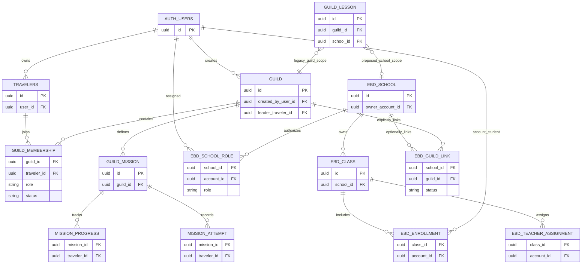

# RPG-COMMUNITY-043A — modelo conceitual de dados

**Modelo de planejamento, não DDL.** Entidades novas e chaves propostas exigem contrato próprio, leitura de schema/dados no início da fase e aprovação antes de qualquer migration.

## Separação de domínios

`AUTH_USERS` e `TRAVELERS` não se fundem. Uma conta pode ter mais de um avatar; EBD nova autoriza a conta, enquanto combate/economia continuam sujeitos ao avatar e às authorities atuais.

## Dados observados hoje

| Entidade real | Campos-chave observados | Restrição/implicação |
| --- | --- | --- |
| `public.guilds` | id, name, description, created_by_user_id, leader_traveler_id, status, timestamps | Não tem visibilidade/política de entrada. RLS ativo; policy de leitura atual é para membro. |
| `public.guild_members` | guild_id, traveler_id, role, status, timestamps | Unique `(guild_id, traveler_id)`; index parcial ativo `(traveler_id, guild_id)` não unique. Papéis leader/co_leader/moderator/member. |
| `public.guild_invites` | guild_id, invited/invited_by traveler, status/expiry | Convite direcionado a avatar; não substituir o fluxo privado por lista pública. |
| `public.guild_join_requests` | guild_id, traveler, status, reviewer, timestamps | Unique pendente `(guild_id, traveler_id)`, não global. |
| `public.guild_missions` | guild_id, creator traveler, objective, mode, reward_tier, status, metadata, dates | Definições ligadas a Guilda; tier legado não autoriza novo payout. |
| `public.guild_mission_progress` / `guild_mission_attempts` | mission/traveler, status/revision/request/evidence/review | Progresso e submissões ligadas a avatar; replays devem ser deduplicados em autoridade comum do evento. |
| `public.guild_reward_claims` | mission, traveler, tier, xp_awarded, coins_awarded | Unique `(mission_id, traveler_id)`; não prova dedupe do evento em outras missões/Guildas. |
| `public.guild_lessons` | guild_id, created_by_traveler, related_mission, conteúdo, teacher_id, ebd_class_id | `guild_id NOT NULL`; material de aula permanece Guild-bound. |
| `public.guild_ebd_teachers`, activities, answers, attendance, history, reward_pending | Guild/aula/turma e IDs de traveler; resposta/presença têm ator avatar | Preservar IDs, conteúdos, snapshots e histórico. RLS está ativo nas tabelas públicas consultadas. |
| `ebd_class_private.classes` | id, guild_id, name, description, status, revision, created_by, timestamps | `guild_id NOT NULL`; schema privado, não uma escola independente. |

Consulta TEST/PROD encontrou o mesmo conjunto de tabelas e colunas Guild/EBD nessas áreas consultadas; volumes e históricos diferem. Não há `ebd_schools` nem `school_id` na modelagem Guild/EBD verificada. As instâncias têm sequência de migrations diferente e foram avaliadas separadamente.

## Modelo futuro recomendado

| Entidade conceitual | Chave e relações propostas | Guardas |
| --- | --- | --- |
| `ebd_schools` | id, owner/account Auth, estado, nome/descrição privada, timestamps | Sem guild_id ou traveler_id obrigatório; nome e perfil públicos só por publicação explícita allowlisted. |
| `ebd_school_roles` | `(school_id, account_id, role)` ou ID + unique funcional; concessão, estado, ator e revisão | Sem derivação de membership/cargo global; revogação versionada. |
| `ebd_classes` | id, `school_id`, nome/estado/revision | Escola é dona da turma; nome não revela estudante. |
| `ebd_enrollments` | id, `class_id`, `account_id`, estado e datas; `traveler_id` só para legado quando comprovado | Não inferir conta de um avatar por nome ou posse; cada operação checa a matrícula atual. |
| `ebd_teacher_assignments` | school/class + account + escopo de ação + estado/intervalo | Atribuição mínima por turma; professor não herda administração escolar/global. |
| `ebd_guild_links` | `school_id`, `guild_id`, consentimentos dos dois escopos, estado/revogação | Link não cria matrícula, visibilidade escolar nem herança de cargo; não atravessa dados pessoais por padrão. |
| Evento/recompensa de missão | id canônico do evento + definição/versão/janela + participantes + receipt reference | Idempotência e dedupe globais por evento antes de contar múltiplas Guildas. Sem carteira paralela. |

### Reutilização da EBD

Não criar cópias automáticas de aulas, atividades, answers, attendance ou history. Estudar expansão aditiva das tabelas existentes: adicionar referência `school_id` opcional; manter `guild_id` para registros legados; somente depois de validar compatibilidade, permitir aulas novas com exatamente um escopo e manter leitores/escritores antigos no escopo Guilda. O estado atual `guild_id NOT NULL` exige mudança de nullability planejada e CHECK de escopo exclusivo; não é possível criar aula escolar na tabela atual apenas adicionando `school_id`.

Respostas/presenças precisam preservar o ator histórico `traveler_id` e acomodar conta Auth para alunos sem avatar, com regra explícita que impeça duas identidades no mesmo registro. Preferir marcador de ator e FK account-level nullable/aditivo, com constraints compatíveis; nenhum backfill de identidade por inferência. Escolas legadas/turmas/classe ambígua permanecem sem associação escolar nova até mapeamento individual aprovado.

## Chaves, índices e retenção

- Membership da Guilda: unicidade por par Guilda/avatar; consultas por avatar usam índice não único, compatível com multiguild. Solicitação pendente continua única por Guilda/avatar.
- Classe, aula, atividade, tentativa, matrícula, presença e receipt devem ter chaves idempotentes compatíveis com o domínio. Não usar unique global por traveler que bloqueie legitimamente vínculo a várias Guildas.
- Cada FK nova deve explicitar `ON DELETE` segundo retenção; preferir arquivo lógico/estado arquivado a cascade para histórico escolar, missão e auditoria.
- Não incluir e-mail, UUID Auth, roster, respostas ou presença no diretório. Hashes agregados são para validar preservação de migration, nunca para autorizar usuário.
- Nomes são recomendações para entendimento, não nomes homologados de tabela ou função.
