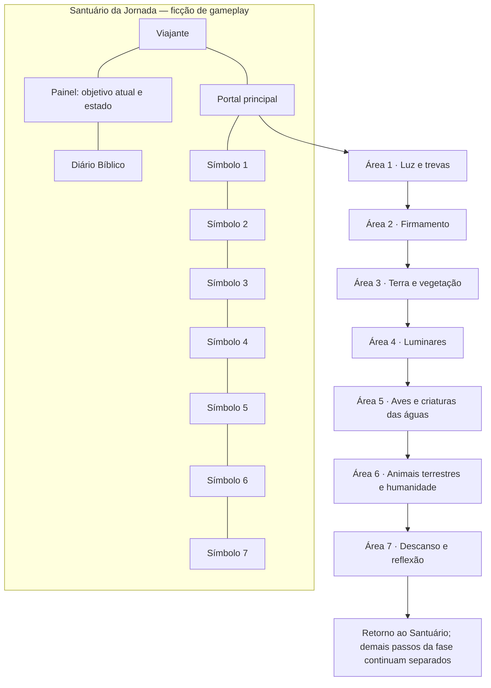

# STORY-002 — Exploração do Viajante: contrato técnico e visual

STATUS: ESPECIFICAÇÃO DOCUMENTAL CONCLUÍDA; runtime não implementado
MUNDO: Mundo 1 — As Origens
FASE: Fase 1 — No Princípio de Tudo
IDENTIDADE DE CONTEÚDO: `world_id=origins`, `story_id=creation`
REFERÊNCIA: Gênesis 1:1–2:3
BASE REVISADA: `codex/story-001a-rewards-planning` @ `c27b608f59e2c6ce25897b886b3d0f4b494bcaa4`
PRÓXIMA TAREFA: [STORY-002B — Implementação do primeiro cenário jogável](../../tasks/backlog/STORY-002B-first-playable-scene.md)

## 1. Fronteiras editoriais e de produto

O **Santuário da Jornada** é um ambiente fictício de gameplay que serve como entrada visual dos mundos. A interface deve identificá-lo como “Santuário da Jornada — espaço fictício do jogo”. Nunca o descrever como local de Gênesis nem sugerir que a Bíblia relata esse espaço.

O Viajante é controlado pelo jogador. Deus não aparece como avatar, personagem controlável, NPC ou representação visual no cenário. Usar formas, luz, ambiente e texto bíblico aprovado; não encenar Deus como agente de gameplay.

Os sete títulos e temas de área vêm do pedido desta tarefa. O material existente `apps/web/features/story/origins-lessons.ts` já tem um exercício candidato chamado “O mosaico dos dias” e sete associações correspondentes, mas está marcado `review: 'candidate'`. Pode ser referência para reaproveitamento e planejamento; não o tratar como conteúdo aprovado. As associações, textos de feedback, ilustrações e referências específicas de versículos precisam de revisão bíblica/editorial antes de publicação. Esta especificação não cria assets, texto bíblico novo ou conteúdo pronto para produção.

Preservar o orçamento, sem o implementar: **500 XP, 200 moedas, 2 Baús Comuns, 1 Baú Raro e 1 Baú Épico**. Manter inalteradas as quatro chaves de concessão do [STORY-001A](../../tasks/completed/STORY-001A-biblical-journey-rewards.md). Nenhum componente deste contrato pode dar XP/moedas/baús. O crédito atual de Mundo Origens no Economy-041 (30 moedas + Baú Comum) continua sem resolução para a composição da Fase 1. Bloquear claims até haver política econômica versionada, conteúdo elegível e pools publicados. Não mudar Economy-041 nesta tarefa.

## 2. Auditoria de reaproveitamento no commit-base

| Necessidade | Implementação encontrada | Uso previsto / limite |
| --- | --- | --- |
| Avatar e identidade | `features/journey/components/avatar-runtime.tsx`, `AvatarRuntime`; `domain/traveler.ts`; `Shell` e `RequireTraveler` | Reutilizar o avatar renderizado e o Viajante autenticado. AvatarRuntime não fornece física nem controle de movimento. |
| Exploração 2D | `features/journey/components/garden-exploration.tsx`, CSS Modules e `garden-mobile.module.css` | Reutilizar padrão de cenário responsivo, pontos de interação, movimento WASD/setas ou toque no chão e obstáculos simples. É específico do Jardim: guarda inventário/moedas e conteúdo legado; não copiar sua lógica de recompensa, estado ou narrativa. |
| Rota e história | `features/story/catalog.ts`, `story-screen.tsx`, `world-map.tsx`, `progression.ts` | Reutilizar catálogo, rota `/journey/stories/creation`, leitor dos passos, mapa/estado de história e apresentação. Não criar página diferente por dia. `creation` está como `candidate`, com vídeo ausente e recompensa nula. |
| Aula da Criação | `features/story/origins-lessons.ts` | A atividade “O mosaico dos dias” e seus sete pares são candidatos de conteúdo; revisar antes de ativar. |
| Diário | `/journey/diary`, `DiaryScreen`, `diaryView` e `journey-spotlight.tsx` | Linkar para a tela existente; não criar outro diário nem armazenar respostas pessoais de reflexão pelo cenário. |
| Leitura de progresso | `useStoryProgress` e `lib/supabase/repositories/story-repository.ts` | Consultar `story_progress` pelo Viajante selecionado; conclusão chama RPC protegida `complete_story`. A aplicação não possui RPC para gravar um checkpoint de área. |
| Persistência local | `journey-storage.ts` e `updateTraveler` | `journeyRepository` usa `localStorage` do navegador e sincronização de Viajante existente. É armazenamento por dispositivo, não autoridade de conclusão nem checkpoint compartilhado entre dispositivos. Não gravar conclusão/evidência de missão neste caminho. |
| Evidência e conclusão no servidor | `packages/database/proposals/task0081-story-progress.sql` | A proposta registra uma linha por passo e história, chave primária `traveler_id/story_id/revision/step`; sete IDs de área não cabem nesse contrato atual. A proposta é local, não é migration aplicada. Não executar SQL nem alterar schema. |

A tela atual `GardenExploration` contém movimentação de posição percentual, distância de interação, limite de cenário e uma área bloqueada simples. Ela é um padrão de interação reaproveitável, não uma cena do Santuário nem a base de conclusão da história `creation`. O mapa de mundo existente e `AdventurePortals` são navegação entre sistemas; não representam as sete áreas.

## 3. Diagrama espacial e fluxo

No cenário visual, os sete símbolos compõem um arco legível atrás do portal. Estados são comunicados por texto/ícone além de cor: bloqueado, disponível, concluído. O painel resume área atual e próxima ação. O Diário é um link direto identificado. O Portal principal abre a próxima área obrigatória disponível; não exige explorar símbolos opcionais nem coletar 100%.

## 4. Especificação das sete áreas

Cada linha define uma missão de gameplay distinta com identidade de conteúdo estável proposta `creation-day-1` a `creation-day-7`. Esses IDs identificam áreas/missões; **não** são chaves de recompensa. A chave agregada de concessão das sete missões continua `story:creation:missions:all-seven:v1` e só pertence ao contrato STORY-001A.

| Área / cenário | Objetivo e ponto de interação | Desafio educativo | Evidência de conclusão | Checkpoint e transição |
| --- | --- | --- | --- | --- |
| **1 — Dia 1: Luz e trevas.** Cena abstrata de contraste claro/escuro; sem figura divina. | Abrir o marco do dia no portal/placa da área e associar o símbolo apresentado ao título do Dia 1. | Selecionar “Luz e trevas” para o Dia 1, conforme os rótulos fornecidos/aprovados. Tentativas ilimitadas; sem cronômetro. | Recibo server-side para `creation-day-1` após resposta validada contra conteúdo publicado. Visitar área sem concluir o desafio não conta. | Checkpoint inicial na entrada do Dia 1; conclusão registra o último dia contínuo e habilita Dia 2. |
| **2 — Dia 2: Firmamento.** Camadas visuais simples de céu e águas, sem acrescentar cosmologia. | Inspecionar o símbolo e associar ao título do Dia 2. | Selecionar “Firmamento” para o Dia 2. O enunciado/feedback final usa texto editorialmente aprovado. | Recibo server-side `creation-day-2`. | Início do Dia 2 é checkpoint após Dia 1; conclusão habilita Dia 3. |
| **3 — Dia 3: Terra e vegetação.** Superfícies gráficas de terra/vegetação, sem espécies nomeadas. | Inspecionar o símbolo e associar ao título do Dia 3. | Selecionar “Terra e vegetação” para o Dia 3. | Recibo server-side `creation-day-3`. | Início do Dia 3 é checkpoint após Dia 2; conclusão habilita Dia 4. |
| **4 — Dia 4: Luminares.** Ícones abstratos para os luminares; sem afirmações científicas sobre duração/órbita. | Inspecionar o símbolo e associar ao título do Dia 4. | Selecionar “Luminares” para o Dia 4. Não acrescentar nomes, funções ou escalas que não estejam no conteúdo aprovado. | Recibo server-side `creation-day-4`. | Início do Dia 4 é checkpoint após Dia 3; conclusão habilita Dia 5. |
| **5 — Dia 5: Aves e criaturas das águas.** Silhuetas/ícones não específicos no céu e na água. | Inspecionar o símbolo e associar ao título do Dia 5. | Selecionar “Aves e criaturas das águas” para o Dia 5. | Recibo server-side `creation-day-5`. | Início do Dia 5 é checkpoint após Dia 4; conclusão habilita Dia 6. |
| **6 — Dia 6: Animais terrestres e humanidade.** Ícones de animais e pessoas sem retratar Deus; diversidade de pessoas não recebe valores mecânicos diferentes. | Inspecionar o símbolo e associar ao título do Dia 6. | Selecionar “Animais terrestres e humanidade” para o Dia 6. Nenhuma resposta pontua dignidade ou mérito. | Recibo server-side `creation-day-6`. | Início do Dia 6 é checkpoint após Dia 5; conclusão habilita Dia 7. |
| **7 — Dia 7: Descanso e reflexão.** Cena estática e tranquila; sem cronômetro, rotina diária ou punição por sair. | Interagir com o símbolo de descanso. Abrir o Diário é opção visível, mas não requisito de conclusão. | Associar “Descanso e reflexão” ao Dia 7. Convite de reflexão pode ser lido, adiado ou ignorado; resposta não é avaliada nem guardada pelo cenário. | Recibo server-side `creation-day-7` quando o desafio factual publicado é concluído. Responder à reflexão não gera evidência. | Checkpoint após Dia 6; concluir libera retorno ao Santuário. Isso não conclui sozinho o Quiz, grande desafio, vídeo ou fase inteira. |

O cartão contextual opcional “Consultar referência” usa o link/ContextPanel existente. Descobertas opcionais nesta especificação são somente leitura de contexto aprovado; sem colecionáveis, segredos, XP, moedas, baús ou dependências de conclusão. Ficar fora da rota obrigatória não reduz status nem recompensa.

## 5. Interação, câmera, colisão e acessibilidade

### Movimento e câmera

- Exploração 2D top-down em uma área por tela, com câmera fixa. Não seguir o Viajante, não fazer zoom/pan e não carregar mundo 3D.
- Em desktop: WASD/setas movem; clique em chão livre desloca para o destino; E ou Enter interage com o ponto próximo/focado. Tab navega pelos pontos e comandos da interface.
- Em mobile: toque em chão livre move; tocar ponto abre cartão de objetivo; botão explícito “Interagir” executa ação. Não depender de hover, pressionamento longo, arraste ou joystick.
- Usar coordenadas normalizadas da área (padrão já usado em `GardenExploration`), controles com alvo mínimo de 44 px, cena sem rolagem horizontal a 360 px. Painel em fluxo abaixo/ao lado da cena conforme largura, sem cobrir ponto ativo.
- Movimento interpolado curto e interrompível; com `prefers-reduced-motion`, reduzir a deslocação para mudança imediata/sem tween e remover efeitos de luz pulsantes.

### Colisões e pontos de interesse

- Cada área publica limites caminháveis e obstáculos estáticos simples como retângulos/polígonos 2D; nenhuma biblioteca física.
- Bloquear entrada/saída do limite, passagem por obstáculo e movimento que corte um obstáculo entre a posição inicial e o destino. Não basta testar somente o ponto final.
- Pontos de interesse são botões DOM reais, focáveis e nomeados. Uma área concluída continua consultável; a ação não emite nova evidência nem recompensa.
- Resolução de desafio é separada de aproximação e visita. Movimento nunca conclui missão sozinho.

### Navegação acessível alternativa ao mapa

A lista “Áreas da Criação” acompanha o portal e oferece os mesmos estados e comandos em semântica HTML. Botões anunciam nome, estado e ação; foco visível; instruções fora do canvas/arte; feedback com `role=status`; erros com `role=alert`. O cenário é decorativo para tecnologia assistiva quando a lista equivalente estiver disponível. Toda informação de cor tem rótulo/texto e ícone. Deve operar com teclado, toque, leitor de tela, zoom de texto e movimento reduzido.

## 6. Painel, Diário, salvamento e retomada

- Painel de missão expõe título da área, objetivo em uma frase, referência vigente aprovada, estado (bloqueado/disponível/concluído), “Interagir” e “Consultar referência”.
- Link “Diário Bíblico” navega para `/journey/diary`, preservando Viajante selecionado pelo Shell existente. Diário/reflexões permanecem pessoais e não entram em prova de missão.
- Identidade é a sessão Auth verificada já usada pela aplicação, combinada ao Viajante que a conta possui; chamadas de progresso devem continuar usando os repositórios/provas server-side existentes. Não enviar/aceitar UUID de outro usuário nem confiar no ID indicado pelo cliente sem validação de propriedade.
- Leitura de `story_progress` continua sendo a fonte canônica existente entre sessões/dispositivos para passos já registrados. Não usar o snapshot de `localStorage` como prova oficial nem escrever nele moedas, baús ou estado que represente um recibo servidor.
- **Bloqueio de persistência por área:** atualmente há progresso agregado por história/passo, mas não há checkpoint por dia. A proposta TASK-0081 registra no máximo um recibo por `traveler/story/revision/step`, portanto não pode provar sete áreas separadamente. Para persistir/resumir área atual entre dispositivos será necessária extensão server-side versionada com identidade Auth + Viajante, `story_id=creation`, `area_id=creation-day-N`, revisão do conteúdo e recibo de conclusão validado. Esta especificação não escolhe tabela/RPC, não abre endpoint cliente e não cria migration.
- Enquanto a extensão não estiver aprovada e disponível, uma cena em protótipo pode manter posição temporária só na memória do componente; após reload, recomeça a área ainda não concluída. Se existir passo agregado confirmado pelo servidor, ele continua visível/retomável conforme `StoryProgress`. A interface deve dizer claramente quando não puder salvar progresso de área; nunca exibir “salvo em todos dispositivos” sem recibo persistido.
- Os desbloqueios seguem apenas prefixo contínuo de áreas com recibos de servidor; cliente não pode pular dias alterando estado local. Concluir a sétima área apenas conclui o conjunto de missões. A Fase 1 só fecha pelas exigências separadas do STORY-001A, incluindo Quiz, grande desafio e vídeo.

## 7. Arquitetura de componentes a reutilizar

Implementar no STORY-002B com React/Next.js e CSS Modules já usados no app. O diagrama não exige dependência, novo serviço ou engine.

| Componente proposto | Responsabilidade | Reuso existente |
| --- | --- | --- |
| `WorldExplorer` | Compor Santuário ou uma área com identidade e progresso | Padrão de composição de `StoryScreen` e `GardenExploration` |
| `ExplorerScene` | Renderizar cena 2D, limites, camada de avatar e botões de pontos | Estrutura DOM/CSS de `GardenExploration`; `AvatarRuntime` |
| `MovementController` | Normalizar teclado/toque/clique, movimento e colisão | Extrair lógica pequena de movimento/limite do Garden sem carregar regras do Jardim |
| `InterestPoint` | Botão semântico de alvo/interação com estados | Botões de pontos existentes no `GardenExploration` |
| `MissionPanel` | Objetivo, estado, ação e referência | Painel/ContextPanel atual; lista HTML como alternativa |
| `BibleDiaryLink` | Navegar para Diário e manter Viajante/retorno | Rota `/journey/diary` e `Shell` atuais |
| `AreaCheckpointAdapter` | Converter estado confirmado do servidor em área disponível/retomável | Novo adaptador futuro sobre `useStoryProgress`/repository; não existe hoje e não deve simular persistência |
| `AreaTransition` | Abrir a próxima área autorizada e exibir transição | Derivação de estado `progression.ts`; sem gravação local autoritativa |

Os componentes apresentados como “propostos” não existem com esses contratos no commit-base. A implementação deve primeiro confirmar imports/consumidores e extrair apenas lógica que tenha mais de um uso real; sem refatoração ampla de `GardenExploration`.

## 8. Gates para implementação/publicação

**Pode iniciar** a construção isolada de um protótipo visual jogável de uma área se usar apenas conteúdo explicitamente fornecido/revisado, não conceder nem simular rewards, e deixar a posição como temporária.

**Bloqueia progresso persistente/uso com usuários** até:

1. Aprovar editorialmente o texto/atividade candidata, referências, feedbacks e representação visual dos dias.
2. Definir e revisar a evidência server-side para sete áreas e retomada cross-device; nenhuma escrita direta do cliente.
3. Publicar conteúdo e vídeo autorizados e assegurar os flags `content_ready/video_ready/reward_ready`.
4. Resolver Economy-041 sem alterar as chaves STORY-001A nem somar a recompensa de mundo sobre o teto.
5. Verificar que os pools Common/Rare/Epic estão ativos antes de qualquer claim futuro; não ativar grants nesta tarefa.
6. Verificar segurança, acesso de Traveler/Auth e regressões só no escopo da implementação posterior.

Nenhum gate aqui autoriza migration remota, alteração em produção, alteração de Guildas, grant, deploy ou uso de asset não aprovado.

## 9. Aceite documental

- [x] Definir Santuário como ficção de gameplay, sem atribuí-lo ao texto de Gênesis.
- [x] Definir as sete áreas, objetivos, interação, desafio, prova, checkpoint e transição.
- [x] Definir movimento desktop/mobile, câmera fixa, colisões simples e limites de processamento.
- [x] Definir painel, pontos de interesse e alternativa acessível em lista.
- [x] Auditar avatar, exploração, roteiro, Diário e progresso existentes para evitar duplicação.
- [x] Identificar que a persistência atual não prova cada área e registrar condição cross-device.
- [x] Preservar as metas do STORY-001A e as quatro chaves sem ativar concessões.
- [x] Registrar bloqueio da política Economy-041, conteúdo e pools.
- [ ] Conteúdo/ilustrações revisados por editor bíblico antes de publicação.
- [ ] Extensão de prova/checkpoint server-side aprovada antes de persistir os sete dias.
- [ ] Implementar primeiro cenário em STORY-002B e executar somente QA direcionado ao escopo.

